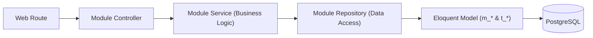

# Dokumentasi Desain Sistem: FameSpace

Aplikasi Manajemen Ruang Keluarga berbasis Laravel 12 & PostgreSQL dengan antarmuka Warm Green Neobrutalism.

---

## 1. Arsitektur Sistem & Pola Modular

FameSpace mengadopsi pola **Modular Architecture** yang dipadukan dengan **Service-Repository Pattern**. Setiap domain fungsional dipecah menjadi modul independen di dalam `app/Modules/`:



### Tanggung Jawab Lapisan (Layer Responsibilities):
1. **Controller**: Menerima request HTTP, validasi form request, mengembalikan respons JSON/Blade. Tidak ada query DB atau logika bisnis kompleks.
2. **Service**: Eksekusi aturan bisnis (kalkulasi saldo, awarding poin reward, validasi invoice, hashing password, kalkulasi tanggal expired +30 hari, penanganan file upload).
3. **Repository**: Mengenkapsulasi query database, Eloquent builder, eager loading, dan persistensi data ke tabel `m_*` dan `t_*`.
4. **Model**: Definisi schema, casting atribut, scope multi-tenant `family_id`, dan relasi antar tabel.

---

## 2. Struktur Folder Modul (Best Practice)

```
app/
├── Models/                           # Eloquent Models m_* & t_*
│   ├── Family.php                    # m_families
│   ├── User.php                      # m_users
│   ├── Plan.php                      # m_plans
│   ├── Category.php                  # m_categories
│   ├── Subscription.php              # t_subscriptions
│   ├── SubscriptionPayment.php       # t_subscription_payments
│   ├── Chore.php                     # t_chores
│   ├── Finance.php                   # t_finances
│   ├── Event.php                     # t_events
│   └── TimelineMoment.php            # t_timeline_moments
│
├── Modules/                          # Pemecahan Kode Per Modul
│   ├── Auth/
│   │   ├── Controllers/AuthController.php
│   │   ├── Controllers/RegisterController.php
│   │   ├── Services/AuthService.php
│   │   ├── Repositories/UserRepository.php
│   │   └── Requests/RegisterRequest.php
│   │
│   ├── Family/
│   │   ├── Controllers/FamilyController.php
│   │   ├── Services/FamilyService.php
│   │   └── Repositories/FamilyRepository.php
│   │
│   ├── Dashboard/
│   │   ├── Controllers/DashboardController.php
│   │   └── Services/DashboardOverviewService.php
│   │
│   ├── Chore/
│   │   ├── Controllers/ChoreController.php
│   │   ├── Services/ChoreService.php
│   │   └── Repositories/ChoreRepository.php
│   │
│   ├── Finance/
│   │   ├── Controllers/FinanceController.php
│   │   ├── Services/FinanceService.php
│   │   ├── Repositories/FinanceRepository.php
│   │   └── Requests/StoreTransactionRequest.php
│   │
│   ├── Subscription/
│   │   ├── Controllers/SubscriptionController.php
│   │   ├── Services/SubscriptionService.php
│   │   ├── Repositories/SubscriptionRepository.php
│   │   └── Repositories/PaymentRepository.php
│   │
│   ├── Calendar/
│   │   ├── Controllers/EventController.php
│   │   ├── Services/EventService.php
│   │   └── Repositories/EventRepository.php
│   │
│   └── Timeline/
│       ├── Controllers/TimelineController.php
│       ├── Services/TimelineService.php
│       └── Repositories/TimelineRepository.php
│
└── Http/Middleware/
    ├── FamilyScopeMiddleware.php     # Isolasi data keluarga
    └── EnsureProPlanMiddleware.php   # Gatekeeper fitur Pro
```

---

## 2. Spesifikasi Skema Database PostgreSQL

Semua tabel menggunakan konvensi:
- **`m_*` (Master Data)**: Entitas induk, data konfigurasi, dan katalog referensi.
- **`t_*` (Transaction & Operational)**: Data aktivitas berkala, mutasi, transaksi pembayaran, log, dan konten dinamis.

### 2.1 Tabel Master (`m_*`)

#### `m_families` (Master Ruang Keluarga)
Menyimpan identitas entitas ruang keluarga dan konfigurasi keuangannya.

| Kolom | Tipe Data | Constraint | Keterangan |
| :--- | :--- | :--- | :--- |
| `id` | `UUID` | `PRIMARY KEY` | Identifier unik keluarga |
| `name` | `VARCHAR(100)` | `NOT NULL` | Nama keluarga (misal: "Keluarga Santoso") |
| `invite_code` | `VARCHAR(12)` | `UNIQUE, NOT NULL` | Kode unik ajakan (format: `FAM-XXXX`) |
| `monthly_budget` | `NUMERIC(15,2)` | `DEFAULT 0.00` | Target kas bulanan |
| `currency` | `VARCHAR(5)` | `DEFAULT 'IDR'` | Mata uang acuan |
| `created_at` | `TIMESTAMP` | `DEFAULT CURRENT_TIMESTAMP` | Waktu dibuat |
| `updated_at` | `TIMESTAMP` | `DEFAULT CURRENT_TIMESTAMP` | Waktu diperbarui |

*Index*: `CREATE INDEX idx_families_invite_code ON m_families(invite_code);`

---

#### `m_users` (Master Anggota & Akun Pengguna)
Menyimpan data anggota keluarga, kredensial autentikasi, peran rumah tangga, dan akumulasi poin.

| Kolom | Tipe Data | Constraint | Keterangan |
| :--- | :--- | :--- | :--- |
| `id` | `BIGSERIAL` | `PRIMARY KEY` | Identifier pengguna |
| `family_id` | `UUID` | `REFERENCES m_families(id) ON DELETE CASCADE` | Relasi ke ruang keluarga |
| `name` | `VARCHAR(100)` | `NOT NULL` | Nama lengkap anggota |
| `email` | `VARCHAR(150)` | `UNIQUE, NOT NULL` | Email untuk autentikasi |
| `password` | `VARCHAR(255)` | `NOT NULL` | Password ter-hash (Bcrypt) |
| `role` | `VARCHAR(30)` | `DEFAULT 'Lainnya'` | Nilai: `Ayah`, `Ibu`, `Anak`, `ART`, dll |
| `points` | `INTEGER` | `DEFAULT 0` | Total skor reward gamifikasi |
| `avatar_url` | `VARCHAR(255)` | `NULLABLE` | Path file atau URL foto avatar |
| `remember_token` | `VARCHAR(100)` | `NULLABLE` | Token sesi "Ingat Saya" |
| `created_at` | `TIMESTAMP` | `DEFAULT CURRENT_TIMESTAMP` | Waktu pendaftaran |
| `updated_at` | `TIMESTAMP` | `DEFAULT CURRENT_TIMESTAMP` | Waktu diperbarui |

*Index*: `CREATE INDEX idx_users_family_id ON m_users(family_id);`

---

#### `m_plans` (Master Paket Langganan)
Katalog tier langganan aplikasi (Free vs Pro).

| Kolom | Tipe Data | Constraint | Keterangan |
| :--- | :--- | :--- | :--- |
| `id` | `BIGSERIAL` | `PRIMARY KEY` | Identifier paket |
| `code` | `VARCHAR(50)` | `UNIQUE, NOT NULL` | Kode unik (`free`, `pro_monthly`) |
| `name` | `VARCHAR(100)` | `NOT NULL` | Label paket (misal: "Famespace Pro Bulanan") |
| `price` | `NUMERIC(15,2)` | `DEFAULT 0.00` | Tarif (Rp 20.000) |
| `duration_days` | `INTEGER` | `DEFAULT 30` | Durasi masa aktif dalam hari |
| `features` | `JSONB` | `NOT NULL` | Daftar fitur: `["timeline", "calendar", "unlimited_members"]` |
| `is_active` | `BOOLEAN` | `DEFAULT TRUE` | Status aktif paket |
| `created_at` | `TIMESTAMP` | `DEFAULT CURRENT_TIMESTAMP` | Waktu dibuat |
| `updated_at` | `TIMESTAMP` | `DEFAULT CURRENT_TIMESTAMP` | Waktu diperbarui |

---

#### `m_categories` (Master Kategori Keuangan)
Klasifikasi kategori pemasukan dan pengeluaran kas.

| Kolom | Tipe Data | Constraint | Keterangan |
| :--- | :--- | :--- | :--- |
| `id` | `BIGSERIAL` | `PRIMARY KEY` | Identifier kategori |
| `family_id` | `UUID` | `NULLABLE, REFERENCES m_families(id) ON DELETE CASCADE` | NULL untuk preset bawaan sistem |
| `name` | `VARCHAR(50)` | `NOT NULL` | Nama kategori (Belanja, Listrik, Uang Saku) |
| `type` | `VARCHAR(10)` | `NOT NULL` | Nilai: `income` atau `expense` |
| `icon` | `VARCHAR(50)` | `DEFAULT 'receipt'` | Nama icon |
| `color` | `VARCHAR(20)` | `DEFAULT '#2F5233'` | Hex warna tag kategori |
| `created_at` | `TIMESTAMP` | `DEFAULT CURRENT_TIMESTAMP` | Waktu dibuat |
| `updated_at` | `TIMESTAMP` | `DEFAULT CURRENT_TIMESTAMP` | Waktu diperbarui |

---

### 2.2 Tabel Transaksi & Operasional (`t_*`)

#### `t_subscriptions` (Status Langganan Ruang Keluarga)
Menyimpan state aktif langganan ruang keluarga per periode berjalan.

| Kolom | Tipe Data | Constraint | Keterangan |
| :--- | :--- | :--- | :--- |
| `id` | `BIGSERIAL` | `PRIMARY KEY` | Identifier status langganan |
| `family_id` | `UUID` | `NOT NULL, REFERENCES m_families(id) ON DELETE CASCADE` | Relasi ruang keluarga |
| `plan_id` | `BIGINT` | `NOT NULL, REFERENCES m_plans(id)` | Relasi ke paket |
| `status` | `VARCHAR(20)` | `DEFAULT 'active'` | Nilai: `active`, `expired`, `cancelled` |
| `starts_at` | `TIMESTAMP` | `NOT NULL` | Awal masa aktif |
| `expires_at` | `TIMESTAMP` | `NOT NULL` | Akhir masa aktif |
| `auto_renew` | `BOOLEAN` | `DEFAULT FALSE` | Penanda perpanjangan otomatis |
| `created_at` | `TIMESTAMP` | `DEFAULT CURRENT_TIMESTAMP` | Waktu dibuat |
| `updated_at` | `TIMESTAMP` | `DEFAULT CURRENT_TIMESTAMP` | Waktu diperbarui |

*Index*: `CREATE INDEX idx_subscriptions_family_status ON t_subscriptions(family_id, status);`

---

#### `t_subscription_payments` (Riwayat Transaksi & Invoice Langganan)
Menyimpan log audit transaksi pembayaran dan tagihan Pro.

| Kolom | Tipe Data | Constraint | Keterangan |
| :--- | :--- | :--- | :--- |
| `id` | `BIGSERIAL` | `PRIMARY KEY` | Identifier pembayaran |
| `invoice_number` | `VARCHAR(50)` | `UNIQUE, NOT NULL` | Format: `INV-YYYYMMDD-XXXX` |
| `subscription_id`| `BIGINT` | `NULLABLE, REFERENCES t_subscriptions(id)` | Relasi langganan |
| `family_id` | `UUID` | `NOT NULL, REFERENCES m_families(id) ON DELETE CASCADE` | Ruang keluarga pemesan |
| `user_id` | `BIGINT` | `NOT NULL, REFERENCES m_users(id)` | Anggota yang mengeksekusi pembayaran |
| `plan_id` | `BIGINT` | `NOT NULL, REFERENCES m_plans(id)` | Paket yang dibayar |
| `amount` | `NUMERIC(15,2)` | `NOT NULL` | Nominal bayar |
| `payment_method` | `VARCHAR(50)` | `NOT NULL` | `Simulasi`, `QRIS`, `Transfer Bank` |
| `status` | `VARCHAR(20)` | `DEFAULT 'pending'` | Nilai: `pending`, `paid`, `expired`, `failed` |
| `paid_at` | `TIMESTAMP` | `NULLABLE` | Waktu pembayaran diverifikasi |
| `reference_code` | `VARCHAR(100)` | `NULLABLE` | Kode referensi transaksi |
| `created_at` | `TIMESTAMP` | `DEFAULT CURRENT_TIMESTAMP` | Waktu penerbitan tagihan |
| `updated_at` | `TIMESTAMP` | `DEFAULT CURRENT_TIMESTAMP` | Waktu pembaruan status |

*Index*: `CREATE INDEX idx_sub_payments_family_id ON t_subscription_payments(family_id);`

---

#### `t_finances` (Pencatatan Arus Kas Keluarga)
Menyimpan mutasi masuk dan keluar kas rumah tangga.

| Kolom | Tipe Data | Constraint | Keterangan |
| :--- | :--- | :--- | :--- |
| `id` | `BIGSERIAL` | `PRIMARY KEY` | Identifier transaksi |
| `family_id` | `UUID` | `NOT NULL, REFERENCES m_families(id) ON DELETE CASCADE` | Relasi ruang keluarga |
| `user_id` | `BIGINT` | `NOT NULL, REFERENCES m_users(id)` | Pencatat mutasi |
| `category_id` | `BIGINT` | `REFERENCES m_categories(id) ON DELETE SET NULL` | Kategori kas |
| `type` | `VARCHAR(10)` | `NOT NULL` | `income` (masuk) atau `expense` (keluar) |
| `amount` | `NUMERIC(15,2)` | `NOT NULL` | Nominal dana |
| `description` | `VARCHAR(255)` | `NOT NULL` | Catatan transaksi |
| `receipt_path` | `VARCHAR(255)` | `NULLABLE` | Lokasi file foto struk/bukti |
| `transaction_date`| `DATE` | `NOT NULL` | Tanggal riil transaksi |
| `created_at` | `TIMESTAMP` | `DEFAULT CURRENT_TIMESTAMP` | Waktu pencatatan |
| `updated_at` | `TIMESTAMP` | `DEFAULT CURRENT_TIMESTAMP` | Waktu diperbarui |

*Index*: `CREATE INDEX idx_finances_family_date ON t_finances(family_id, transaction_date);`

---

#### `t_chores` (Tugas Rumah Tangga & Gamifikasi Poin)
Menyimpan penugasan tugas harian keluarga dan reward skornya.

| Kolom | Tipe Data | Constraint | Keterangan |
| :--- | :--- | :--- | :--- |
| `id` | `BIGSERIAL` | `PRIMARY KEY` | Identifier tugas |
| `family_id` | `UUID` | `NOT NULL, REFERENCES m_families(id) ON DELETE CASCADE` | Relasi keluarga |
| `assigned_to_user_id`| `BIGINT` | `NULLABLE, REFERENCES m_users(id) ON DELETE SET NULL`| Anggota yang ditugaskan |
| `title` | `VARCHAR(150)` | `NOT NULL` | Judul tugas (misal: "Cuci Piring Makan Malam") |
| `description` | `TEXT` | `NULLABLE` | Petunjuk atau detail tugas |
| `points` | `INTEGER` | `DEFAULT 10` | Poin reward saat tugas selesai |
| `due_date` | `DATE` | `NULLABLE` | Batas waktu pengerjaan |
| `status` | `VARCHAR(20)` | `DEFAULT 'pending'` | Nilai: `pending`, `completed` |
| `completed_at` | `TIMESTAMP` | `NULLABLE` | Waktu diverifikasi selesai |
| `created_at` | `TIMESTAMP` | `DEFAULT CURRENT_TIMESTAMP` | Waktu dibuat |
| `updated_at` | `TIMESTAMP` | `DEFAULT CURRENT_TIMESTAMP` | Waktu diperbarui |

---

#### `t_events` (Agenda Kalender Bersama - Fitur Pro)
Menyimpan agenda bersama kegiatan keluarga (jadwal dokter, arisan, liburan).

| Kolom | Tipe Data | Constraint | Keterangan |
| :--- | :--- | :--- | :--- |
| `id` | `BIGSERIAL` | `PRIMARY KEY` | Identifier agenda |
| `family_id` | `UUID` | `NOT NULL, REFERENCES m_families(id) ON DELETE CASCADE` | Relasi keluarga |
| `created_by_user_id`| `BIGINT` | `NOT NULL, REFERENCES m_users(id)` | Pembuat agenda |
| `title` | `VARCHAR(150)` | `NOT NULL` | Judul agenda |
| `description` | `TEXT` | `NULLABLE` | Catatan agenda |
| `start_time` | `TIMESTAMP` | `NOT NULL` | Waktu mulai |
| `end_time` | `TIMESTAMP` | `NULLABLE` | Waktu selesai |
| `location` | `VARCHAR(150)` | `NULLABLE` | Lokasi kegiatan |
| `created_at` | `TIMESTAMP` | `DEFAULT CURRENT_TIMESTAMP` | Waktu dibuat |
| `updated_at` | `TIMESTAMP` | `DEFAULT CURRENT_TIMESTAMP` | Waktu diperbarui |

---

#### `t_timeline_moments` (Linimasa Kenangan & Catatan Liburan - Fitur Pro)
Menyimpan foto dokumentasi dan cerita momen kebersamaan keluarga.

| Kolom | Tipe Data | Constraint | Keterangan |
| :--- | :--- | :--- | :--- |
| `id` | `BIGSERIAL` | `PRIMARY KEY` | Identifier momen |
| `family_id` | `UUID` | `NOT NULL, REFERENCES m_families(id) ON DELETE CASCADE` | Relasi keluarga |
| `user_id` | `BIGINT` | `NOT NULL, REFERENCES m_users(id)` | Pengunggah |
| `title` | `VARCHAR(150)` | `NOT NULL` | Judul kenangan |
| `story` | `TEXT` | `NULLABLE` | Narasi atau cerita momen |
| `image_path` | `VARCHAR(255)` | `NOT NULL` | Lokasi file foto kenangan |
| `event_date` | `DATE` | `NOT NULL` | Tanggal terjadinya momen |
| `created_at` | `TIMESTAMP` | `DEFAULT CURRENT_TIMESTAMP` | Waktu diunggah |
| `updated_at` | `TIMESTAMP` | `DEFAULT CURRENT_TIMESTAMP` | Waktu diperbarui |

---

## 3. Sistem Desain Neobrutalism (Warm Green)

Sistem visual diadaptasi secara presisi dari file template di folder `DESIGN LAYOUT`:

### 3.1 Palet Warna
- **Brand Green**: `#2F5233` (Utama), `#1E3821` (Gelap/Hover), `#3F6B44` (Muda), `#EAF0EB` (Soft Background)
- **Background Cream**: `#FBF8EF` (Warna dasar halaman)
- **Ink Black**: `#121614` (Batas tegas, teks kontras, dan bayangan brutalist)
- **Mustard Gold**: `#F2C94C` (Aksen utama, tombol aksi, badge highlight)
- **Coral Warm**: `#E07A5F` (Badge badge Pro / alert / penolakan)
- **Sage Muted**: `#87A987` (Aksen sekunder)
- **Sky Blue**: `#81B0C4` (Informasi sekunder)

### 3.2 Tipografi
- **Body & Sans**: `'Plus Jakarta Sans'`, sans-serif (Weight: 500, 600, 700, 800)
- **Display & Headings**: `'Space Grotesk'`, sans-serif (Weight: 600, 700, 900)
- **Monospace & Angka**: `'JetBrains Mono'`, monospace (Untuk angka nominal kas, kode undangan, tanggal)

### 3.3 Utilitas CSS Brutalist
- **Border**: `border: 2.5px solid #121614`
- **Shadow**: `box-shadow: 4px 4px 0px 0px #121614` (Standard), `box-shadow: 6px 6px 0px 0px #121614` (Besar), `box-shadow: 2px 2px 0px 0px #121614` (Kecil)
- **Button Hover Interaction**: `transform: translate(-2px, -2px); box-shadow: 6px 6px 0px 0px #121614;`
- **Button Active Interaction**: `transform: translate(2px, 2px); box-shadow: 1px 1px 0px 0px #121614;`

---

## 4. Struktur View Blade Modular

```
resources/views/
├── components/
│   ├── brutal-button.blade.php
│   ├── brutal-card.blade.php
│   ├── brutal-badge.blade.php
│   └── paywall-modal.blade.php
├── layouts/
│   ├── app.blade.php             # Master layout dashboard (Sidebar + Topbar)
│   └── guest.blade.php           # Layout halaman auth & landing
├── landing.blade.php             # Porting dari index.html
├── auth/
│   ├── login.blade.php           # Porting dari login.html (+ 1-klik demo)
│   └── register.blade.php        # Porting dari register.html (Wizard 3 langkah)
└── dashboard/
    ├── index.blade.php           # Main container single-tab switcher
    ├── tabs/
    │   ├── overview.blade.php    # Tab ringkasan kas, tugas hari ini, upcoming
    │   ├── chores.blade.php      # Tab daftar tugas & checklist gamifikasi
    │   ├── finance.blade.php     # Tab rekap kas, saldo, form catat transaksi
    │   ├── timeline.blade.php    # Tab linimasa foto kenangan (Fitur Pro)
    │   ├── calendar.blade.php    # Tab kalender agenda flatpickr (Fitur Pro)
    │   └── members.blade.php     # Tab manajemen anggota & kode undangan
    └── modals/
        ├── task-modal.blade.php
        ├── expense-modal.blade.php
        ├── timeline-modal.blade.php
        └── event-modal.blade.php
```
