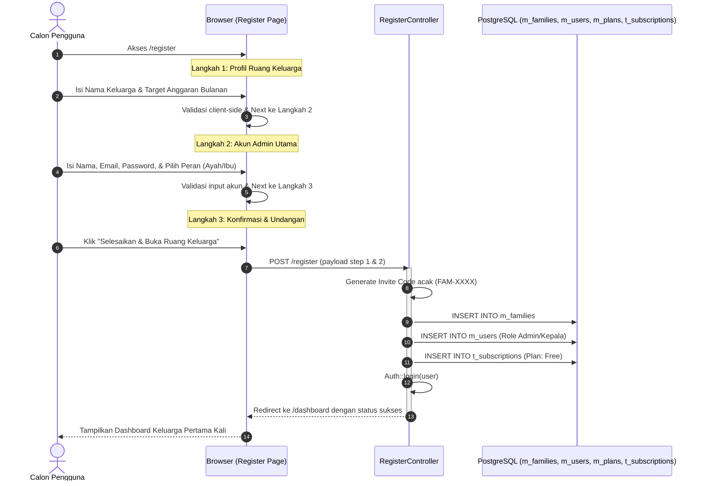
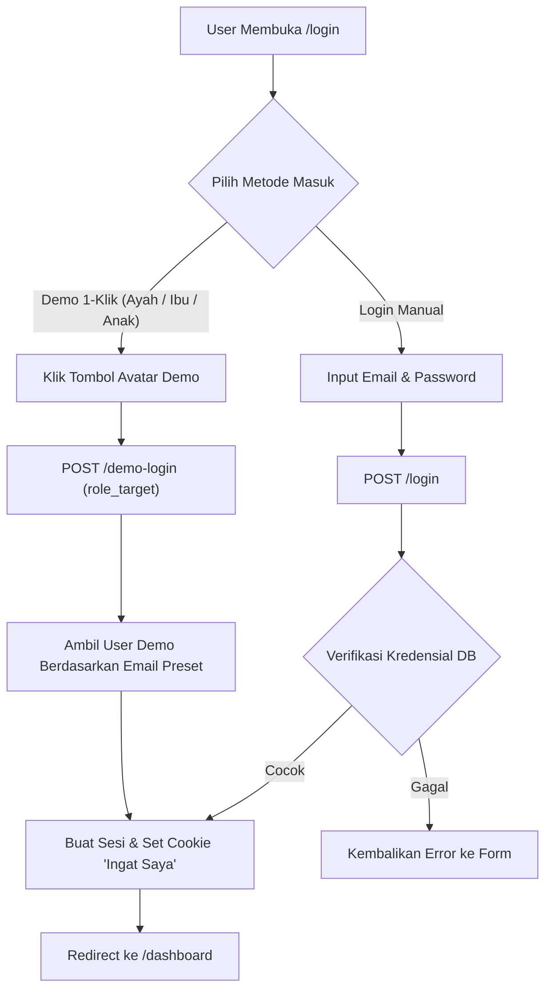
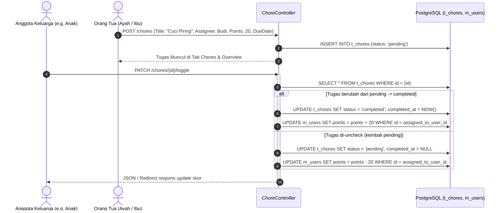
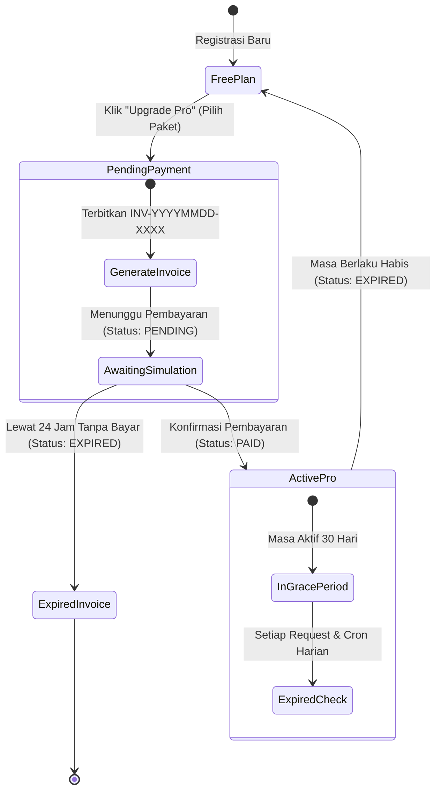

# Dokumentasi Proses Bisnis & Alur Operasional: FameSpace

Dokumen ini mendefinisikan seluruh alur operasional (*business flows*), *user journey*, mekanisme state machine, serta SOP sistem pada aplikasi FameSpace.

---

## 1. Alur 1: Pendaftaran & Onboarding Ruang Keluarga (Wizard 3 Langkah)

Alur registrasi dirancang memandu pengguna baru membangun fondasi ruang keluarga secara bertahap tanpa kebingungan.



### Detail Langkah Onboarding:
1. **Langkah 1 (Keluarga)**:
   - Input: `family_name` (wajib, max 100 karakter).
   - Input: `budget_monthly` (opsional, format mata uang rupiah).
   - Input: `currency` (default: IDR).
2. **Langkah 2 (Admin)**:
   - Input: `role` (radio button: Ayah, Ibu, Anak, dll).
   - Input: `name`, `email` (harus unik di `m_users`), `password` (min 8 karakter).
3. **Langkah 3 (Undangan)**:
   - Sistem menerbitkan `invite_code` unik 6 digit (contoh: `FAM-7729`).
   - Tautan pendaftaran anggota instan: `https://famespace.id/join/FAM-7729`.

---

## 2. Alur 2: Autentikasi & Login Cepat (Demo 1-Klik)

FameSpace menyediakan form login standar email/password serta shortcut simulasi 1-klik untuk pengujian multi-peran (Ayah, Ibu, Anak) secara instan.



---

## 3. Alur 3: Manajemen Tugas Harian & Gamifikasi Poin (Chores)

Membagi tanggung jawab rumah tangga dan memberikan insentif psikologis berupa reward poin untuk setiap tugas yang diselesaikan anggota.



---

## 4. Alur 4: Pengelolaan Arus Kas Keluarga & Bukti Struk (Finance)

Memastikan seluruh pengeluaran dan pemasukan tercatat rapi secara kolektif dengan kalkulasi saldo otomatis.

1. **Pencatatan**:
   - Anggota membuka form modal catat kas.
   - Mengisi jenis (`pemasukan` atau `pengeluaran`), nominal (Rp), kategori (dari `m_categories`), tanggal, dan deskripsi.
   - Opsional: Mengunggah foto struk belanja / bukti transfer (`.jpg`, `.png`, max 2MB).
2. **Penyimpanan**:
   - File struk divalidasi dan disimpan di storage disk lokal (`storage/app/public/receipts/`).
   - Data transaksi dicatat ke tabel `t_finances`.
3. **Agregasi Dashboard**:
   - Total Pemasukan = `SUM(amount)` where `type = 'income'`.
   - Total Pengeluaran = `SUM(amount)` where `type = 'expense'`.
   - Saldo Kas Berjalan = `Total Pemasukan - Total Pengeluaran`.
   - Indikator Target Bulanan: Membandingkan total pengeluaran terhadap `monthly_budget` pada tabel `m_families`.

---

## 5. Alur 5: Siklus Langganan Pro, Invoice, & Penanganan Expired (Hybrid)

Menjelaskan perjalanan transaksi upgrade Pro (Rp 20.000/bulan) per keluarga, pembuatan nomor invoice unik, aktivasi masa berlaku, dan pencegahan akses saat expired.



### 5.1 Alur Penerbitan Invoice & Pembayaran
1. Pengguna (Ayah/Ibu) mengklik tombol *"Upgrade ke Paket Pro"* dari Paywall Modal.
2. Endpoint `POST /subscriptions/checkout`:
   - Membuat rekaman baru di `t_subscription_payments` dengan status `pending`.
   - Menghasilkan nomor invoice berformat `INV-{YYYYMMDD}-{URUTAN}`.
   - Menghasilkan rincian pembayaran: Total Rp 20.000.
3. Simulasi Pembayaran Instan / Konfirmasi:
   - Endpoint `POST /subscriptions/simulate-pay/{invoice_number}`.
   - Mengubah status pembayaran menjadi `paid` dan mencatat `paid_at = now()`.
   - Mengupdate atau membuat record di `t_subscriptions`:
     - `status = 'active'`
     - `starts_at = now()`
     - `expires_at = (existing_expires_at > now() ? existing_expires_at : now()) + 30 days`
   - Mengirim notifikasi / toast sukses ke tampilan browser.

### 5.2 Mekanisme Deteksi & Penguncian Expired (Hybrid)
Sistem menerapkan perlindungan ganda (real-time dan batch cron):

1. **Gatekeeper Middleware (Real-time)**:
   - Diterapkan pada route fitur Pro (`/timeline/*`, `/events/*`, dan API terkait).
   - Middleware `EnsureProPlan` memeriksa:
     ```php
     $subscription = $family->activeSubscription;
     if (!$subscription || now()->greaterThan($subscription->expires_at)) {
         return redirect()->route('dashboard', ['tab' => 'overview', 'paywall' => 'true']);
     }
     ```
   - Di tampilan UI Dashboard, jika keluarga dalam status `Free` atau `Expired`:
     - Tombol tab Kalender dan Linimasa menampilkan badge `PRO 🔒`.
     - Ketika diklik, modal paywall otomatis terbuka menampilkan rincian paket Rp 20.000/bln.
2. **Command Otomatis Terjadwal (Batch Cron)**:
   - Command Artisan: `php artisan subscription:check-expired`.
   - Dijalankan setiap hari pukul 00:01 WIB via Laravel Scheduler.
   - Logika:
     ```sql
     UPDATE t_subscriptions 
     SET status = 'expired', updated_at = NOW() 
     WHERE status = 'active' AND expires_at < NOW();
     ```
   - Invoice pending yang tidak diselesaikan dalam 24 jam ditandai sebagai `expired`.

---

## 6. Alur 6: Kalender Bersama & Linimasa Momen (Fitur Pro)

### 6.1 Agenda & Kalender Keluarga (`t_events`)
- Integrasi library Flatpickr (Brutalist style) untuk pemilihan tanggal & rentang jam.
- Pengguna mencatat agenda: Ulang tahun, janji temu dokter, jadwal imunisasi anak, liburan.
- Agenda ditampilkan dalam kalender visual dan rekap list 7 hari ke depan pada tab Overview.

### 6.2 Linimasa & Rekap Jejak Liburan (`t_timeline_moments`)
- Mengunggah foto dokumentasi kegiatan keluarga (file path disimpan di storage publik).
- Menambahkan judul momen, tanggal kejadian, dan cerita ringkas.
- Disajikan dalam format feed polaroid Neobrutalism berurutan dari tanggal terbaru ke terlama.
